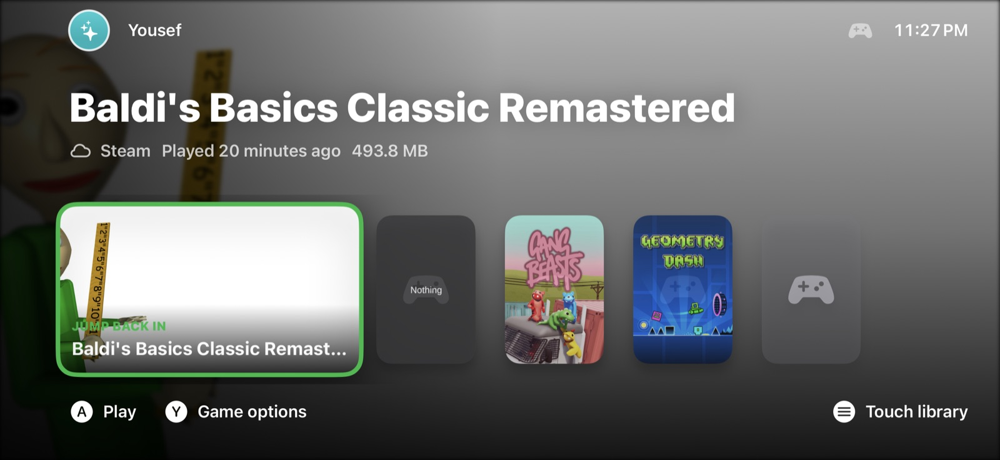
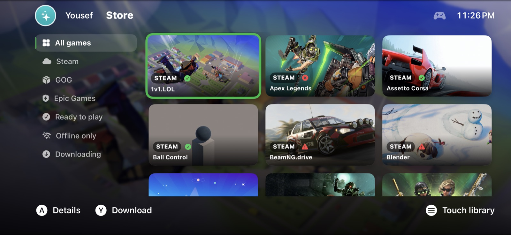
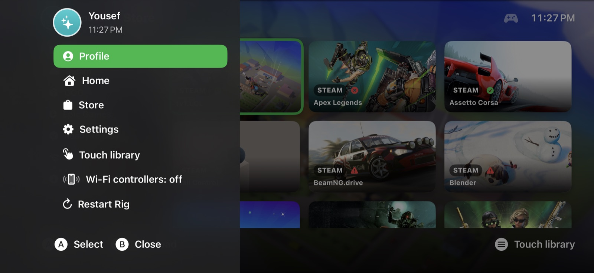
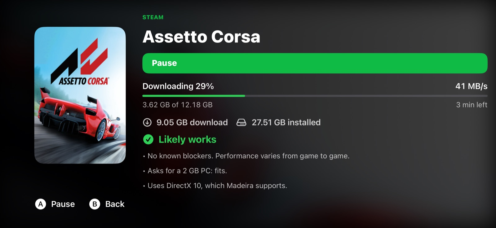
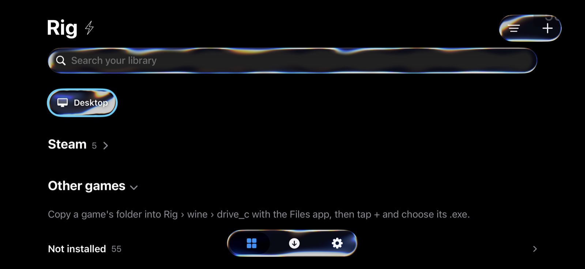

# RIG

**Your gaming PC, in your pocket.** RIG runs Windows PC games on an iPhone with
no jailbreak. Games run unmodified inside a single iOS app, with a console-style
home screen built for a controller.

RIG is built on [Madeira](https://github.com/willfaust/Madeira) by Will Faust
and its contributors. It keeps Madeira's engine (FEX-Emu, Wine, DXMT and
Madeira's Direct3D 12 runtime) and adds its own interface, stores and quality-of-life features on top.

> [!NOTE]
> RIG is an experimental, personal project. Many games start and some play
> well, but performance and compatibility vary from game to game.

> **Tested on an iPhone 16 Pro Max** (8 GB, iOS 27) and an **iPad Air 4**
> (4 GB, iPadOS 27). Other recent iPhones and iPads should work; devices with
> 4 GB of memory get a low-memory profile and run lighter games.

## Screenshots

<p align="center">
  
  
</p>
<p align="center">
  
  
</p>
<p align="center">
  
</p>

| | |
|---|---|
| **Home** | Jump back in to your last game, with your library underneath. |
| **Store** | Steam, GOG and Epic Games together, with filters and compatibility badges. |
| **Guide** | The Xbox button opens it from anywhere: profile, store, settings, restart. |
| **Store page** | Download progress, download versus installed size, and whether it will run. |
| **Touch library** | Everything also works by touch when no controller is connected. |

## What RIG adds

### A console home screen
- **Controller-first home** in the style of a games console: a "Jump back in"
  tile, your library as large art tiles, and button hints along the bottom.
- **Guide**: press the **Xbox / Home button** (or View + Menu) for Profile,
  Home, Store, Settings, Wi-Fi controllers and Restart.
- **In-game guide**: the same buttons during a game open Resume, **Quit game**,
  FPS limit, performance overlay and touch controls, all driven by the controller.
- **Battery at a glance**: your iPhone or iPad battery and your controller's,
  next to the clock and in the guides.
- **Close Rig** from the guide, without reaching for the screen.
- **Optional tab bar** across the top (Home / Store / Settings, switched with LB
  and RB), off by default.
- **Themes**: accent colours, animated backgrounds (waves, orbs, aurora,
  particles, glow) or your own photo, and a startup animation.
- **Profile**: name, a photo or built-in avatar, and a profile page with your
  games, installed size, last played and connected stores. Set up during onboarding.
- Layout that fills the screen edge to edge and keeps clear of the Dynamic Island.

### Stores
- **Steam**, **GOG** and **Epic Games** in one store with filters (all, per
  store, ready to play, offline only, downloading).
- **GOG**: sign in (Google sign-in supported), browse, download and install
  owned games. Older GOG releases (first-generation builds) download too, and
  GOG games find their install folder the way they do on Windows.
- **Epic Games**: sign in (including passkeys through Safari), install owned
  games, and launch them signed in.
- **Store pages** with screenshots you can open full screen (and browse with
  the controller), description, size and requirements.
- **Compatibility estimates** for every game, with precise anti-cheat labels
  (*Might work*, *Offline only*, *Won't run*) so you know before downloading.
- Clear sizes: what a game **downloads** versus how much **space it needs**,
  and a download ETA down to the second.
- Store pages and art cached, so they open instantly the second time.

### Running games
- **Session doctor**: explains crashes after the fact, warns on low memory, and a
  **heat guard** drops games to 30 FPS while the phone is hot.
- **Reopen after a close**: if RIG closes or crashes, a notification brings it
  back. A Shortcuts action, *"Did Rig close by itself?"*, can reopen it
  automatically.
- Per-game **graphics presets**, an Unreal Engine fix, a fast CPU mode and known
  profiles for specific games.
- **Easier game deletion** from the library and details page.
- **Low-memory profile** for 4 GB devices such as the iPad Air 4: a smaller JIT
  pool, a lighter video memory budget, a swap file and 30 FPS for new games,
  switched on by itself (Settings › General).
- **Wi-Fi controllers**: other phones on your network join as players 2–4.
- **External display**: the game on a TV while the phone keeps the controls.
- **External drive** support for game installs.
- **Button layouts**: remap every controller button for all games (Settings ›
  Controls) or give one game its own layout from its page. The Xbox / Home
  button always opens the guide.
- **Quake II from GOG** sets itself up: RIG fetches
  [Yamagi Quake II](https://www.yamagi.org/quake2/) (checksum-pinned), keeps
  GOG's files as backups, and starts it full screen with controller binds.
- Better mouse wheel and pointer lock, and controllers that are detected even by
  games that only look for one at startup.

RIG does not bypass DRM or anti-cheat. Games whose anti-cheat blocks
emulation are labelled as such.

## Requirements

- An iPhone or iPad on **iOS 26 or later**. RIG is tested on an
  **iPhone 16 Pro Max** (iOS 27) and an **iPad Air 4** (iPadOS 27); 4 GB devices
  like the iPad Air 4 get a low-memory profile and run lighter games.
- **JIT**, which iOS only allows while a debugger is attached, through
  [StikDebug](https://github.com/StikDebug/StikDebug) or the built-in StikJIT
  helper. See [`docs/JIT.md`](docs/JIT.md).
- An **Apple ID** to sideload or build the app.

## Building

```sh
git clone https://github.com/yabdelsa2862-lab/RIG.git
```

Everything is in this one repository, including RIG's versions of Wine, FEX-Emu,
DXMT and the Steam launcher (no submodules to fetch). Open
`app/Madeira.xcodeproj` and build the **Madeira** scheme; the project and
internal names still say Madeira, and the app shows as RIG. The native parts
(Wine unix libraries, ARM64EC modules, FEX, DXMT) are built with the scripts in
[`build/`](build), one folder per component.

| Path | Contents |
|---|---|
| [`app/`](app) | The iOS app: SwiftUI interface, stores, Wine bridge and resources |
| [`wine/`](wine), [`FEX/`](FEX), [`dxmt/`](dxmt), [`madeira-dock/`](madeira-dock) | Wine, the x86 translator, the Direct3D-to-Metal layer and the Steam launcher, with RIG's changes |
| [`build/`](build) | Build scripts and iOS-side sources, one folder per component |
| [`madeira-d3d12/`](madeira-d3d12) | The native Direct3D 12 runtime |
| [`docs/`](docs) | Documentation (inherited from Madeira) |
| [`tests/`](tests), [`tools/`](tools) | Checks and helper scripts |

## License

RIG is licensed, like Madeira, under **GPL-3.0-or-later** ([`LICENSE`](LICENSE))
with the **Madeira Converter Exception** ([`LICENSE-EXCEPTION.md`](LICENSE-EXCEPTION.md)).
Third-party components keep their own licenses; see
[`THIRD-PARTY-NOTICES.md`](THIRD-PARTY-NOTICES.md) and [`LICENSES/`](LICENSES).
Microsoft's Visual C++ runtime is not included.

## Thank you, Madeira

RIG would not exist without [**Madeira**](https://github.com/willfaust/Madeira).
All the hard parts are Madeira's work: running Windows games on an iPhone at all,
the JIT, Wine and FEX on iOS, Direct3D on Metal and Steam support. Thank you to
**Will Faust** ([@willfaust](https://github.com/willfaust)) for creating it and
sharing it as open source, and to everyone who built it with him, including
125hz, Jfishin, JesseLovelace, danperks, bahacan16, spitefulowl, meshoklv and
TheHadesc. If you like RIG, go star and support Madeira.

## Credits

Fixes were also taken from the community forks of
[Notbood](https://github.com/Notbood/Madeira) and
[kuscholar](https://github.com/kuscholar/Madeira).

It is built on [Wine](https://www.winehq.org/), [FEX-Emu](https://github.com/FEX-Emu/FEX),
[DXMT](https://github.com/3Shain/DXMT), [rpmalloc](https://github.com/mjansson/rpmalloc),
[StikDebug](https://github.com/StikDebug/StikDebug), [StikJIT](https://github.com/StikDebug/StikJIT)
and [idevice](https://github.com/jkcoxson/idevice). GOG and Epic support follows the
approach of [Legendary](https://github.com/derrod/legendary) and the GOG Galaxy API.

RIG is not affiliated with Microsoft, Xbox, Valve, GOG or Epic Games.
